<p align="center">
  
</p>

<h1 align="center">Muhammad Hammad</h1>

<p align="center">🟢 Available · Germany</p>

<p align="center">
  IT Infrastructure Engineer. I keep company systems running and locked down:<br />
  cloud, networks, servers, and the laptops people actually sit in front of.
</p>

<p align="center">
  <a href="mailto:muhammad24997@gmail.com"><strong>Get in touch&nbsp;→</strong></a>
  &nbsp;·&nbsp;
  <a href="https://github.com/Muhammadhammad24?tab=repositories"><strong>View projects&nbsp;→</strong></a>
</p>

<p align="center">
  <a href="https://github.com/Muhammadhammad24">GitHub</a> ·
  <a href="https://www.linkedin.com/in/mhammad24/">LinkedIn</a> ·
  <a href="mailto:muhammad24997@gmail.com">Email</a>
</p>

---

## A day in production

<p align="center">
  
</p>

---

## This repository

Personal portfolio site. Single static page, no database, no CMS: the only live
data is read from the GitHub API at build time and refreshed hourly.

### Tech

- **Next.js 15** — App Router, statically rendered
- **TypeScript**
- **Tailwind CSS** + one hand-written design system in `app/globals.css`
- **Framer Motion** — nav, scroll progress, command palette
- **Lucide React** — icons

### Getting started

```bash
npm install
npm run dev
```

Open <http://localhost:3000>.

### Build

```bash
npm run build
npm start
```

### Environment

Copy `.env.local.example` to `.env.local`. Both values are optional — the site
builds and runs without them.

| Variable | Used by | Without it |
| --- | --- | --- |
| `GITHUB_TOKEN` | `components/github-panel.tsx` | Rate limit drops to 60 req/h and the contribution graph is hidden |
| `NEXT_PUBLIC_WEB3FORMS_ACCESS_KEY` | `components/contact-form.tsx` | The form reports that email delivery is not configured |

### Structure

```
app/
  globals.css          # Design tokens, buttons, cards, section rhythm
  layout.tsx           # Root layout, fonts, metadata, favicon
  page.tsx             # The whole page, section by section

components/
  hero-section.tsx     # Name, intro and the day map
  day-map.tsx          # A working day, 08:00 → 17:30, as a diagram
  github-panel.tsx     # Live GitHub data (server component)
  skills-hex.tsx       # Skills grouped in six layers
  certs-hex.tsx        # Certifications, built on hex-gallery
  hex-gallery.tsx      # Shared pick-one-and-read-it gallery
  projects-explorer.tsx
  journey-map.tsx      # Karachi → Göttingen, drawn on globe.tsx
  globe.tsx            # Orthographic globe; coastlines in world-land.ts
  timeline.tsx         # The seven roles, in detail
  contact-form.tsx     # Web3Forms, posted straight from the browser
  floating-nav.tsx     # Floating nav, mobile sheet, section spy
  command-palette.tsx  # ⌘K / Ctrl+K quick menu
  scroll-progress.tsx  # Reading progress bar
  smooth-scroll.ts     # Anchor scrolling, frame-driven
  section-heading.tsx · section-reveal.tsx · glassmorphic-card.tsx
  profile-photo.tsx

hooks/
  use-mobile.tsx       # Viewport-width breakpoint for the nav

public/
  photo_hammad.jpg     # Portrait
  favicon.svg
```
